<!-- Generated by scripts/generate.py: edit the script, not this file -->

<!-- One terminal window cut into slices: align="left" stacks them without gaps, and each project and contact row is a link -->

  
  
  
  
  
  
  
  
  
  

 
